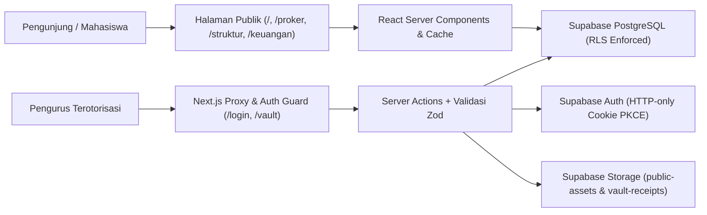

<div align="center">


# HIMATIKA UNIVERSITAS TRILOGI

**Portal Digital Resmi & Sistem Manajemen Terpadu Himpunan Mahasiswa Teknik Informatika**

<p>
  
  
  
  
  
  
</p>

<p>
  <a href="#tentang-proyek">Tentang Proyek</a> •
  <a href="#fitur-utama">Fitur Utama</a> •
  <a href="#arsitektur-sistem">Arsitektur</a> •
  <a href="#struktur-direktori">Struktur Proyek</a> •
  <a href="#menjalankan-secara-lokal">Instalasi Lokal</a>
</p>

</div>

---

## Tentang Proyek

**HIMATIKA Web** adalah perombakan menyeluruh portal resmi **Himpunan Mahasiswa Teknik Informatika (HIMATIKA) Universitas Trilogi**. Proyek ini menggantikan tampilan statis lama dengan web modern berkarakter editorial gelap (*Dark Obsidian*), tipografi `Anton` dan `JetBrains Mono`, aksen biru almamater (`#2563eb`), serta integrasi backend **Supabase**.

Aplikasi dirancang memisahkan **jalur publik** yang cepat dan terindeks rapi di CDN Edge dengan **jalur internal pengurus (`/vault`)** yang dilindungi autentikasi sesi HTTP-only cookie dan **PostgreSQL Row Level Security (RLS)**.

> [!NOTE]
> **Transparansi Kas & Privasi Data:** Halaman publik `/keuangan` menampilkan ringkasan saldo dan daftar mutasi non-sensitif secara *read-only* melalui database view `v_public_finance_records`. Catatan internal, detail penginput, dan berkas bukti kuitansi (`vault-receipts`) tetap terkunci rapat hanya untuk pengurus terotorisasi.

---

## Fitur Utama

### 1. Portal Publik

| Rute | Halaman | Fitur Unggulan |
| :--- | :--- | :--- |
| `/` | **Beranda** | Slideshow foto kegiatan *full-color* teroptimasi `.webp`, slider program kerja unggulan (`ShowcaseSlider`), dan sorotan struktur organisasi. |
| `/about` | **Tentang Kami** | Profil resmi organisasi, visi & misi dinamis (`site_about`), logo dinamis, dan galeri kegiatan beranimasi GSAP `ScrollTrigger`. |
| `/struktur` | **Struktur Organisasi** | Diagram sirkuit SVG interaktif (`OrgBlueprint`) dengan efek *3D Photo Flip Reveal* dan drawer samping rincian tupoksi, anggota, serta proker per divisi. |
| `/proker` & `/proker/[slug]` | **Program Kerja** | Katalog program kerja dengan *sticky filter bar* (status & divisi termasuk `KOLABORASI HIMPUNAN`), rincian rundown, kontak WhatsApp panitia, dan galeri *lightbox*. |
| `/keuangan` | **Transparansi Kas** | Ringkasan pemasukan, pengeluaran, dan saldo kas aktif beserta filter bulan/tahun, *pagination*, dan ekspor laporan CSV. |
| `/contact` | **Hubungi Kami** | Informasi kontak resmi HIMATIKA dan formulir pesan langsung ke database (`contact_messages`) yang terhubung ke kotak masuk pengurus. |

### 2. Portal Pengurus — The Vault (`/login` & `/vault`)

Portal internal yang dilindungi **Supabase Auth (`@supabase/ssr` PKCE)**, guard rute [`src/proxy.ts`](./src/proxy.ts) (`Cache-Control: no-store, private`), metadata `noindex`, serta kontrol akses berbasis peran (**Admin HIMATIKA**, **Bendahara**, **Media Kreatif**):

* **Kas & Kuitansi**: Pemantauan KPI saldo kas, tambah/edit/hapus transaksi, unggah & pratinjau bukti nota privat via *Signed URL* (`vault-receipts`), ekspor CSV, dan tampilan cetak laporan LPJ.
* **Kelola Program Kerja**: Pengelolaan penuh data proker, editor *rundown*, unggah poster utama & multi-foto dokumentasi, serta pembersihan otomatis aset gambar lama di Storage (`public-assets`).
* **Kelola Struktur**: Pembaruan nama pimpinan/koordinator, foto pengurus, daftar anggota, dan tupoksi tiap node organisasi yang langsung tersinkron ke `/struktur`.
* **Kelola Tentang & Hero Slides**: CMS untuk memperbarui narasi `/about`, daftar misi, galeri foto, logo, serta slide foto di beranda utama.
* **Kotak Masuk**: Pengelolaan pesan masuk dari `/contact` dengan filter status (`Belum Dibaca`, `Sudah Dibaca`, `Diarsipkan`) dan aksi balas cepat via email.

---

## Arsitektur Sistem



### Teknologi yang Digunakan

| Lapisan | Teknologi |
| :--- | :--- |
| **Framework & Bahasa** | Next.js `16.4.6` (App Router, Cache Components, Server Actions), React `19.3.0`, TypeScript `5` |
| **Styling & Animasi** | Tailwind CSS `v4`, GSAP `3.15`, Lenis Smooth Scroll, Lucide React |
| **Backend & Database** | Supabase PostgreSQL, Row Level Security (RLS), RPC, Supabase Storage |
| **Keamanan & Validasi** | `@supabase/ssr` (HTTP-only cookies), Zod `v4`, `src/proxy.ts` |
| **CI & Hosting** | GitHub Actions (`npm run lint` & `tsc --noEmit`), Vercel Edge Network & Cron (`/api/keep-alive`) |

---

## Struktur Direktori

```text
├── .github/workflows/ci.yml   # Pengecekan otomatis ESLint & TypeScript di GitHub Actions
├── public/image/              # Aset foto & logo lokal (.webp / .png)
├── src/
│   ├── actions/               # Next.js Server Actions (validasi Zod + revalidasi cache)
│   ├── app/                   # Halaman App Router, /api/keep-alive, robots.ts, sitemap.ts
│   ├── components/            # Komponen UI per fitur (home, proker, diagram, keuangan, about, auth, vault, common, ui)
│   ├── lib/
│   │   ├── auth/              # Helper sesi & hak akses pengurus
│   │   ├── data/              # Query data publik ter-cache & fallback data lokal
│   │   ├── supabase/          # Client Supabase (public, server, browser, middleware, storage)
│   │   ├── site-url.ts        # Resolver URL kanonik untuk metadata & sitemap
│   │   └── utils.ts           # Formatter Rupiah, tanggal, WhatsApp, dan ekspor CSV
│   ├── types/                 # Definisi tipe database & finansial
│   └── proxy.ts               # Interceptor proteksi rute /vault & header privat
├── PROJECT.md                 # Spesifikasi fitur, lingkup divisi, & matriks RBAC
├── ARCHITECTURE.md            # Rancangan arsitektur backend, skema DB, & keamanan RLS
├── DESIGN.md                  # Token desain Dark Obsidian, skala tipografi clamp(), & spesifikasi UI
├── TASK.md                    # Pelacak progres implementasi Fase 0 – Fase 8
└── vercel.json                # Jadwal Vercel Cron anti-pause Supabase Free Plan
```

---

## Menjalankan Secara Lokal

### 1. Clone & Install Dependensi

```bash
git clone https://github.com/Haerulanwar05/himatika_web.git
cd himatika_web
npm install
```

### 2. Konfigurasi Environment Variables

Buat file `.env.local` di root proyek:

```env
NEXT_PUBLIC_SUPABASE_URL=https://<project-ref>.supabase.co
NEXT_PUBLIC_SUPABASE_ANON_KEY=<supabase-anon-key>
NEXT_PUBLIC_SITE_URL=http://localhost:3000

# Opsional di lokal; sangat disarankan di Vercel Production untuk mengunci /api/keep-alive
CRON_SECRET=<string-rahasia-acak>
```

### 3. Jalankan Server Pengembangan & Pengujian Kode

```bash
# Menjalankan mode pengembangan (http://localhost:3000)
npm run dev

# Pemeriksaan kualitas kode & build produksi
npm run lint
npx tsc --noEmit
npm run build
```

<details>
<summary><strong>Catatan Deployment Vercel & Anti-Pause Database</strong></summary>

1. Hubungkan repositori ini ke **Vercel** dan pasang keempat variabel lingkungan di atas pada menu **Settings → Environment Variables**.
2. File `vercel.json` secara otomatis menjadwalkan Vercel Cron ke endpoint `/api/keep-alive` setiap 3 hari (`0 0 */3 * *`) untuk menjaga proyek Supabase Free Plan tetap aktif.
3. Pada **Supabase Dashboard → Authentication → URL Configuration**, atur `Site URL` dan `Redirect URLs` ke domain produksi Vercel yang aktif.

</details>

---

## Dokumentasi Lengkap

* [`PROJECT.md`](./PROJECT.md) — Spesifikasi halaman, daftar divisi resmi, dan matriks hak akses pengurus
* [`ARCHITECTURE.md`](./ARCHITECTURE.md) — Arsitektur dual-plane, skema PostgreSQL, dan aturan Row Level Security
* [`DESIGN.md`](./DESIGN.md) — Standar visual *Dark Obsidian*, formula tipografi `clamp()`, dan pedoman antarmuka
* [`TASK.md`](./TASK.md) — Checklist pengembangan dan daftar persiapan rilis produksi

---

<div align="center">

Dikembangkan untuk **Himpunan Mahasiswa Teknik Informatika (HIMATIKA) Universitas Trilogi**  
Instagram: [@himatika.trilogi](https://www.instagram.com/himatika.trilogi/)

</div>
